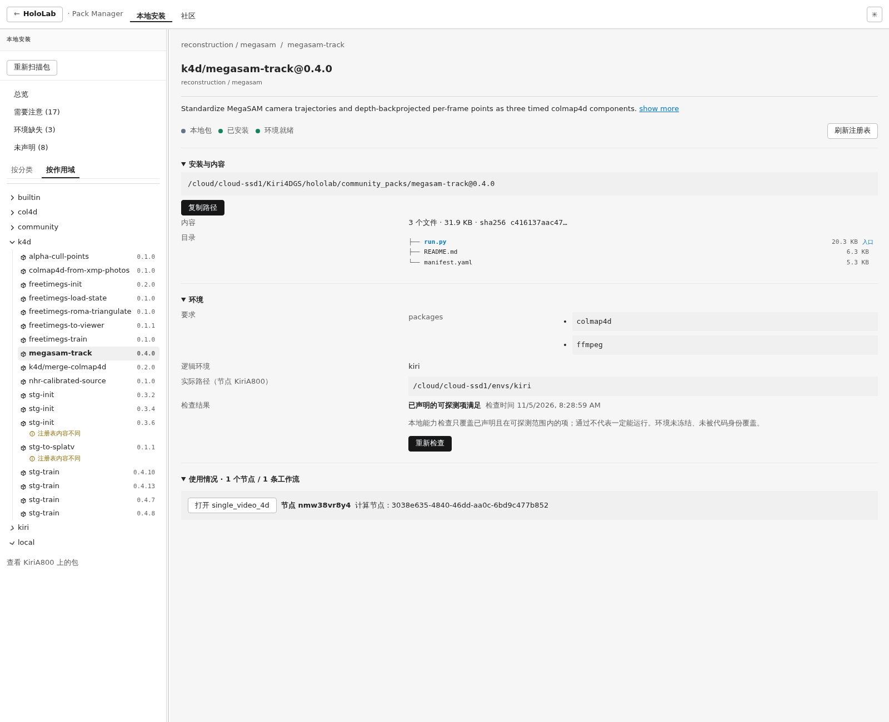
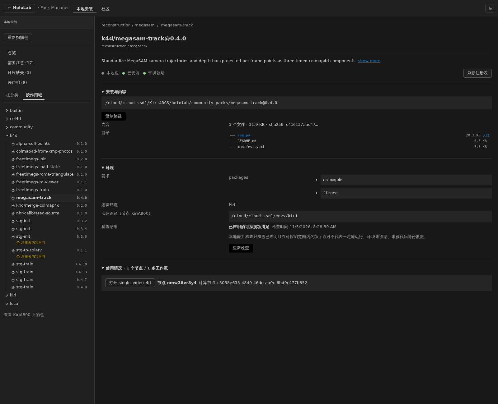

# 三个 4D pack 的 k4d scope 修正（2026-11-05）

三个包已按用户明确授权原位改为 k4d，版本不变，目录不移动。通过现有自动 watcher + 手动 pack reload 确认；没有重启 8828、发布或 push。

## scope 派生机制（改对位置）

- `hololab/package_identity.py:7` 定义 DEFAULT_SCOPE="kiri"，`:51` 的 canonical_name 对裸名加 kiri/。
- `hololab/frontend/src/packageIdentity.ts:2` 同样把裸名规范化为 kiri/name；目录模型通过 packageKey 建索引。
- `hololab/node/packs.py:18` 明确 pack identity 来自 manifest 内容，目录名无需匹配。
  node runtime 的 _load_packs 也以 `(manifest.name, manifest.version)` 建映射；目录不派生 scope。
- 因此显式 `name: k4d/megasam-track` 后，前后端都保留 k4d；不改全局 DEFAULT_SCOPE，避免波及 fastgs/历史裸名。
- STG 对照：当前 `SpacetimeGaussians/packs/stg-train/manifest.yaml:3` 是 `name: k4d/stg-train`、版本 0.4.13；目录仍为 packs/stg-train。
  安装副本 `/root/.hololab/node/packs/k4d/stg-train@0.4.7/content/packs/stg-train@0.4.7/manifest.yaml:3` 同样声明 k4d/stg-train。
  用户举例的 k4d/stg-train@0.3.0 在当前磁盘未找到；只读历史 `git show e202d00^:packs/stg-train@0.3.0/manifest.yaml` 的 name 实为 community/stg-train。
  不把该历史记录说成已核实的 k4d/0.3.0，也不修改它；当前 k4d 实例足以验证声明机制。

## 身份与文件改动

| 目录（保留） | 旧身份 | 新身份 |
|---|---|---|
| community_packs/megasam-track@0.4.0 | megasam-track（别名 kiri/megasam-track） | k4d/megasam-track@0.4.0 |
| community_packs/merge-colmap4d@0.2.0 | col4d/merge-colmap4d | k4d/merge-colmap4d@0.2.0 |
| community_packs/colmap4d-from-xmp-photos@0.1.0 | col4d/colmap4d-from-xmp-photos | k4d/colmap4d-from-xmp-photos@0.1.0 |

修改：三个 manifest 的 name；三个 README 的标题/相互引用；merge manifest docs 的 XMP 新包引用；
`docs/colmap4d-components.md` 的三包身份；XMP 实现 conversion.source 字符串；
`tests/test_megasam_ports_040.py` 增加三包身份/版本断言，`tests/test_colmap4d_xmp_010.py` 同步来源对照。
没有改算法、端口、参数、类型标签、category 或存储格式。旧 merge@0.1.5 目录 git diff 为空。
先前调查/实施报告及截图作为历史证据保留原样；本报告说明新身份，不反改历史记录。

## 原位修正判断与实际引用

用户明确指定三个刚建、未发布版本可原位修正；修前本机 catalog central 均为 absent（缓存状态，原文见 catalog-before.json）。
没有发布或重新上传，版本保持原值。本次 manifest/来源字段变化会改变代码身份。

**“无 workflow 依赖”在本机并不完全成立**：扫描活动 drafts、snapshots、workflow_recipe_intents 后发现
`single_video_4d`（9967b1f8-3646-41f5-a269-394b6d392169）中的 nmw38vr8y4 仍引用 megasam-track@0.4.0。
相关 snapshots 和 recipe intents 为 0，相关 jobs 为 0；另两包没有引用。
为避免此次 scope 修正留下悬空节点，已通过 `/api/workflows` + base_updated_ts 并发检查，把节点算法名和 recipe dependency 改为 k4d/megasam-track。
API-to-API 对照确认原有参数（包括本地视频路径绑定）、节点位置、边 ID/两端端口均保留。
API 的派生 source_label/target_label 不属于持久化边字段，SQLite 也不直接存储本地路径绑定；不能用这两种表示的差异误判参数丢失。
未改旧快照、job 或旧 merge 引用。迁移摘要见 [workflow-migration.json](workflow-migration.json)；原 API 备份在 `/tmp/k4d-scope-workflow-before.json`。

## 重扫与新旧键证据

自动 watcher 已先读入新身份，随后对 KiriA800 调用 `/api/packs/reload`：count=80、manifest_changed=false；
false 表示本次显式重扫相对 watcher 已加载状态没有再次变化，并不是未发现新身份。原文见 [reload.json](reload.json)。

| `/api/pack-catalog?key=...` | 改后条目数 |
|---|---:|
| k4d/megasam-track@0.4.0 | 1 |
| k4d/merge-colmap4d@0.2.0 | 1 |
| k4d/colmap4d-from-xmp-photos@0.1.0 | 1 |
| megasam-track@0.4.0 | 0 |
| kiri/megasam-track@0.4.0 | 0 |
| col4d/merge-colmap4d@0.2.0 | 0 |
| col4d/colmap4d-from-xmp-photos@0.1.0 | 0 |
| col4d/merge-colmap4d@0.1.5（冻结旧包） | 1 |

[修前 catalog 响应](catalog-before.json) · [修后各键响应](catalog-after.json) · [修后 inventory 原文](inventory-after.json)。
此次 `/api/packs` 也仅列这三包的新 k4d 身份，没有上述旧身份；没有直接操作 gateway 数据库清除记录。
其它 col4d scope 老包不属于此次范围，仍保留原身份；“词表修正”不表示清空所有历史 col4d 包。

## schema、回归和实际 UI

- 三份 manifest 均 load_manifest 成功；精确 name/version/hash 见 [schema.json](schema.json)。
- **11 项 unittest 通过**，含三包身份断言、双输入时间/几何、组件严格组装、旧/新 XMP 行为对照。
- 实际已运行的 8828 前端直接验证，无静态资源替换、无 mock：三个新深链在浅/深模式均可见，按作用域树中均列入 k4d。
  6 个浏览器检查结果见 [browser-results.json](browser-results.json)。为便于截图观察，折叠了其它 scope；未改前端代码或部署。

深链：
- [k4d/megasam-track@0.4.0](http://117.50.174.6:8828/packs?view=local&section=category&tree=scope&pack=k4d%2Fmegasam-track%400.4.0)
- [k4d/merge-colmap4d@0.2.0](http://117.50.174.6:8828/packs?view=local&section=category&tree=scope&pack=k4d%2Fmerge-colmap4d%400.2.0)
- [k4d/colmap4d-from-xmp-photos@0.1.0](http://117.50.174.6:8828/packs?view=local&section=category&tree=scope&pack=k4d%2Fcolmap4d-from-xmp-photos%400.1.0)

包详情中的“逻辑环境 kiri”是运行环境别名，与 scope 独立，不应为改 scope 而改动它。

## 并行工作保护

本会话没有改 STG、sharp-4dgs、website、旧 merge@0.1.5 或 node 配置。
期间出现的 docs/architecture.md、docs/pack-spec.md、hololab/node/config.py、executor.py、runtime.py、
hololab/pack_setup.py、tests/test_cache_dirs.py 为其它会话在途改动，未修改或提交。
原有 frontend/dist.bak-20261105-packmanager、旧 reports、父仓库其它子模块与 backups 均保留。
