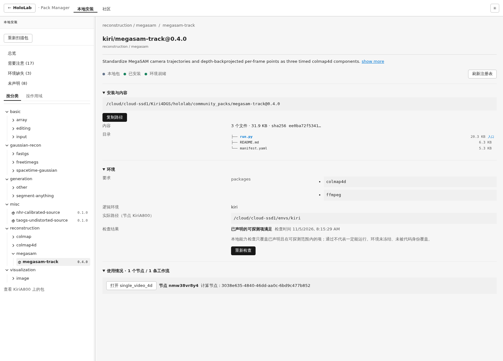
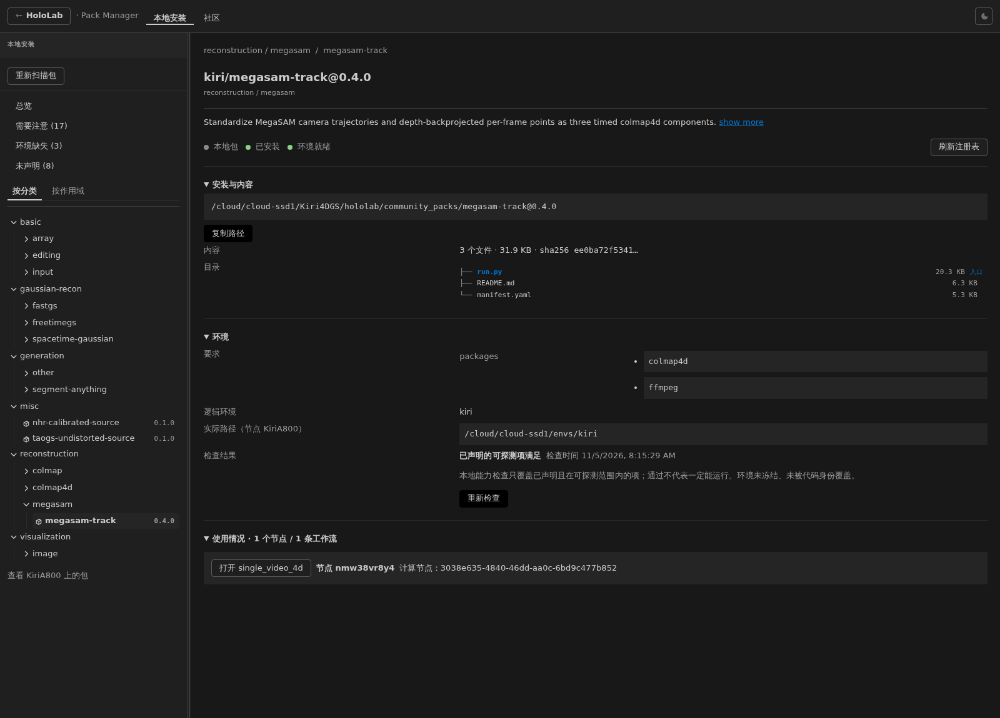

# MegaSAM 包管理器可见性诊断与修复（2026-11-05）

根因是 **local 深链接的包名比较没有归一化**，不是包缺失，也不是 category/central 过滤。
修复已测试、构建，**尚未部署**；未重启 8828，未改 node 配置或任何 pack manifest，未 push。

## 先量后改：数据链

1. `hololab/node/config.py:162` 的 pack_scan_dirs 合并 effective_install_dir 与用户 pack_dirs；
   `hololab/node/runtime.py:307` / `:639` 加载这些目录并向 gateway 上报 inventory。
2. 本机 `/root/.hololab/node/config.yaml:10` 起的 pack_dirs **确实包含**
   `/cloud/cloud-ssd1/Kiri4DGS/hololab/community_packs`（`:16`）。这是当前实际配置，
   与 community_packs 通常只作发布归档的约定不同。本次只读核实，没有追改配置或搬包。
   包详情真实 source_dir 也指向该目录，说明本次不是仅剩历史记录。
3. `/api/packs` 是持久化历史 inventory：`hololab/gateway/app.py:1186`；
   `/api/pack-catalog` 是当前连接节点的可用 manifest 目录：`app.py:1341`、`registry.py:488`。
   catalog 优先使用节点上报 manifest_path，不能把两 API 的含义混为一谈。
4. UI `hololab/frontend/src/packs/PackManager.tsx:124` 同时请求：
   `/api/pack-catalog?key=<当前选择>`、`/api/packs`、`/api/nodes`；`:144` 随后补齐全 catalog。
   `packManagerModel.ts:29` **只由 catalog 创建本地条目**；历史 inventory 只在 `:30` 注释已有条目。
   不通过另一个 node packs API 建树，也没有前端按 pack_dirs 路径排除 community_packs。

## 原始响应及逐项排除

以下为原始 HTTP body 文件（不是重构的 mock）；before/after 指代码修复前后采样，**不代表线上部署前后**。

| 请求 | 修前 | 修后 |
|---|---|---|
| GET /api/packs | [inventory-before.json](inventory-before.json) | [inventory-after.json](inventory-after.json) |
| GET /api/pack-catalog?key=megasam-track%400.4.0 | [requested-catalog-before.json](requested-catalog-before.json) | [requested-catalog-after.json](requested-catalog-after.json) |
| GET /api/pack-catalog?key=kiri%2Fmegasam-track%400.4.0 | [canonical-catalog-before.json](canonical-catalog-before.json) | [canonical-catalog-after.json](canonical-catalog-after.json) |

两种 key 查询均返回 **1 条**；全 catalog 80 条，历史 inventory 97 条。
聚焦响应的相关字段摘录如下（完整原文见上表）：
```json
{
  "name": "megasam-track",
  "version": "0.4.0",
  "node_ids": ["3038e635-4840-46dd-aa0c-6bd9c477b852"],
  "category": ["reconstruction", "megasam"],
  "central": {
    "state": "absent",
    "reason": "not present in configured registry",
    "checked_at": 1793866445.6668553,
    "stale": false
  }
}
```

- **(a) pack_dirs**：包含该目录，在线 catalog 也返回实际包；排除配置缺扫描路径。本次不用改用户配置。
- **(b) category**：manifest `community_packs/megasam-track@0.4.0/manifest.yaml:7` 已声明 reconstruction/megasam；
  UI `PackManager.tsx:202` 按 category 查询前缀过滤，无 category 时 fallback misc；当前 URL 不带 category 参数，不会过滤掉它。
  merge 的分类是 reconstruction/colmap4d，birefnet 是 generation/segment-anything，两者同样在 catalog。
- **(c) central.state**：该包 absent（未发布）符合事实；`PackManager.tsx:249` 的 identical 条件只计算 canInstall，
  `:313` 只影响安装按钮/提示；不会阻止本地详情。`:189` 起的 registryProblemStatus 只是问题状态。
- **(d) 缓存**：全新 Playwright 浏览器会话中，原始 URL 稳定显示“该包当前未发现”；
  同一在线服务、同一客户端改为 kiri/megasam-track 即显示“本地包 / 已安装 / 环境就绪”。
  没要求用户硬刷；这是确定性的 key 不匹配，不是缓存解释。

## 根因及修法

- `hololab/frontend/src/packageIdentity.ts:2` 将无 scope 的名称规范化为 kiri/name，`:3` 构造 packageKey。
- `packs/packManagerModel.ts:19` 用 packageKey 建索引，故此条目的 key 是 **kiri/megasam-track@0.4.0**。
- 原 `packs/packManagerRoute.ts` 直接返回 URL 的原始 pack；
  `PackManager.tsx:207` 却用 `entry.key === selected` 查找，于是原 URL 的 **megasam-track@0.4.0** 不匹配。
- `PackManager.tsx:353` 到 `:357` 进入“未发现”页。已带 scope 的 merge / birefnet 没有此差异。

修改仅限两份 packs 视图源文件：
- `packs/packManagerRoute.ts:9`：local 完整 name@version 按最后一个 @ 拆分，通过现有 packageKey 归一；
  community 链接、已经 scoped 的名称、空/不完整引用保持原样。无需改持久化名称或算法 manifest。
- `packs/packManagerRoute.test.ts`：加入 raw/scoped 等价、默认 local、现有 scoped packs、community 与非法引用回归。

## 验证、截图与部署边界

- Vitest：packManagerRoute、packManagerModel、PackageTree 三文件，**16 项通过**。
- `tsc -b` 通过；`vite build --outDir /tmp/hololab-megasam-pack-manager-dist-20261105` 通过。
  只有现有大 bundle 警告（约 1 MB）；未修改打包配置。
- **构建产物**：`/tmp/hololab-megasam-pack-manager-dist-20261105/`，生产 JS `assets/index-CNnsckVn.js`。
  未覆盖当前 frontend/dist；部署由用户执行。可在确认并行前端改动后部署该目录或从提交重新构建。
- 修后浏览器验证通过：原始 unscoped URL，浅/深模式均看到该版本；merge@0.1.5、merge@0.2.0、birefnet-mask@0.1.2 均显示正常。
  断言结果见 [browser-results.json](browser-results.json)。
- **修后截图为构建预览**：Playwright 仅在该浏览器请求中以独立 build 的 index/assets 替换静态响应；
  所有 `/api` 请求都走真实 8828，没有 mock catalog，没有部署或修改线上静态资源。
  首次预览等待遇到一次超时，随后全套浏览器断言通过；没有修改 API/增加绕过逻辑。

[修前：原始 URL 未发现](before.png)





当前线上无需部署即可用的规范名称链接：
[打开 MegaSAM 本地包](http://117.50.174.6:8828/packs?view=local&section=category&pack=kiri%2Fmegasam-track%400.4.0)。
[线上现有 bundle + 规范 URL 截图](live-canonical-url.png)，此张没有浏览器静态资源替换。

未改 node 配置、pack、website、sharp-4dgs 或其他并行前端文件；所有原有未提交改动保留。
开始诊断时一次连接被拒绝，随后本机/公网均 HTTP 200；本会话未操作服务进程。
