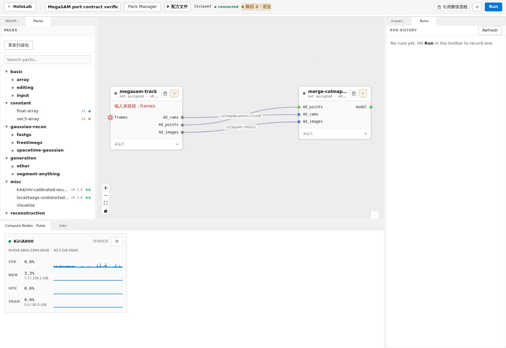
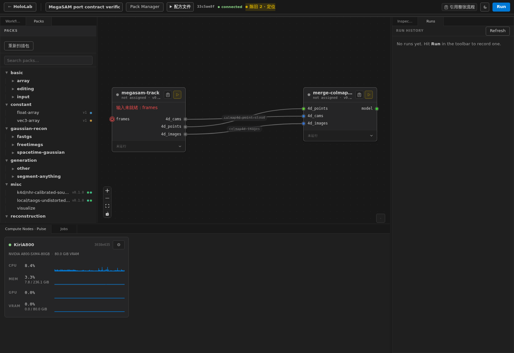

# MegaSAM 双输入与端口改名验收（2026-11-05）

已按用户明确授权直接调整首版 megasam-track@0.4.0 / merge-colmap4d@0.2.0，未另起版本。
未发布 registry、未 push、未重启服务；通过已有 pack watcher / reload API 更新本机 manifest。

## 声明与命名依据

- 已装先例：`/root/.hololab/node/packs/k4d/stg-init@0.3.2/content/packs/stg-init@0.3.2/manifest.yaml:53`，
  colmap_4d 输入使用两个完整 any_of 分支（scalar colmap4d、array[frame] colmap-folder）。本机源码旧路径已不存在，引用实际安装路径；没有改 STG。
- schema：`hololab/manifest/schema.py:65` 定义 PortTypeVariant；`:120` 定义 InputSpec.any_of；`:136` 检查至少两个分支，且不能混用顶层 tags/arrayed/dim_labels/scalar。
- 数组词表：`hololab/builtin_packs/frame-extraction@0.1.1/manifest.yaml:127` 使用 frame_sequence 端口、tags:[image]、arrayed:true、dim_labels:[frame]、storage:dir。
- 命名惯例：上述 frame_sequence，`hololab/builtin_packs/single-video-source@0.1.0/manifest.yaml:45` 的 videos_dir，以及 STG 的 colmap_4d，均为下划线。
  因用户要求跟随现有惯例，使用 **4d_cams / 4d_points / 4d_images**，未采用连字符。数字开头是合法字典键，模板用 bracket lookup。
- 本次声明：`community_packs/megasam-track@0.4.0/manifest.yaml:42`：

```yaml
inputs:
  frames:
    description: One video-source or a flat frame-labelled image array.
    any_of:
      - tags: [video-source]
        arrayed: false
        storage: dir
      - tags: [image]
        arrayed: true
        dim_labels: [frame]
        storage: dir
```

三个输出分别使用 colmap4d-cams / colmap4d-point-cloud / colmap4d-images，tags 未改。
merge 输入同步为相同三键，见 `community_packs/merge-colmap4d@0.2.0/manifest.yaml:34`；磁盘布局和组装算法未改。

**严格性说明**：现有基础 schema 的 extra=ignore 会忽略未知字段，不能宣称它本身拒绝任何拼写错误。
本次增加 `tests/test_megasam_ports_040.py` 的 raw YAML 精确字段/形状断言，任何 any_of 字段拼写或分支形状偏差使测试失败；
同时实测单分支、混用顶层 tags、缺少 tags、非法 storage 抛错，以及只接受 scalar video-source / array[frame]<image>，拒绝 scalar image / array<video-source>。
没有为了本任务修改全局类型系统的兼容行为。

## 两条输入路径与时间口径

- **video**：现有 ffprobe/ffmpeg + 三种 timestamp_mode 保持，默认 exposure_metadata；fps_num/fps_den 用于该路径 synthetic_uniform。
- **array<image>**：不编码中间视频；按元素文件名词典序排序，再应用 skip/max_frames，直接准备规范 PNG 后调用同一 MegaSAM 原生链。
- 帧时间优先级：
  1. 提供 exposure_metadata_path 时，使用与视频相同的 clock_domain、frames[].decoded_index、mid_exposure_ns 或 exposure_start_ns+exposure_ns//2 语义；
     身份字段改为 frames_sha256，绑定整个原始排序数组，非视频哈希。该字段的 canonical JSON/SHA256 算法已写入包 README。
  2. 未提供 JSON 时读取选中帧 HoloLab XMP：namespace `https://hololab.dev/ns/rig/1.0/`，wallClockEpochNs+exposureNs//2；支持 JPEG APP1 / PNG XMP，统一 timebase。
  3. 都没有曝光元数据时，必须显式给新增 `frames_fps`（optional float，无默认、正数，仅数组路径生效）。按原始索引计算 round(index×1e9/fps)，有理运算 ties-even；标 synthetic_uniform/estimated。
- 部分 XMP、非法曝光字段、混合 clock_domain、JSON 身份不符、缺失所选帧均报错，不转而使用 fps；数组路径不受视频 timestamp_mode/fps_num/fps_den 控制。
- 图像必须单帧 RGB/RGBA8、相同尺寸；ICC 转 sRGB，未标色彩图像假定 SDR sRGB，alpha 丢弃。元数据先读取再转换，不依赖转换后的 PNG 保留 XMP。
- `run.py` 的 input_kind / frame_identity / xmp_exposure / prepare_frames / prepare_video。NPZ/高斯边界、点云时间和组件定义不变。

## 引用审计与迁移

本机 8828 SQLite + 文件权威 recipe.json 核查：只有 **single_video_4d**
（workflow `9967b1f8-3646-41f5-a269-394b6d392169`，track `nmw38vr8y4`）引用 0.4.0；
没有名为 Sharp cat 的活动工作流，不能宣称迁移了不存在的本机流程。
逐节点精确检查 snapshots / workflow_recipe_intents：没有引用这两个新契约版本；jobs：0。
文本宽匹配曾命中 4 个无关 snapshot，逐节点解析排除，不把它们当真实引用。

该草稿 track 原先未接线，所以无旧端口边需要重写；但算法名为 `kiri/megasam-track`，与本机安装的 `megasam-track` 不匹配。
已通过 API + base_updated_ts 并发检查修正节点与 recipe dependency 名称；保留旧参数值、节点位置及全部原有边。
界面现在补显新参数 frames_fps=null（无猜测 FPS）；没有代接线路、执行工作流或修改历史快照。
原始 API 响应备份 `/tmp/megasam-ports-workflow-before.json`，迁移记录 `/tmp/megasam-port-migration.json`。

## 验证结果与画布

- 两个修改后的 manifest 均 load_manifest 成功；union 实际类型匹配、字段严格断言、merge Jinja StrictUndefined 渲染通过。
- **11 项 unittest 全部通过**（含多个负向子案例）。视频实际 ffmpeg 解码：4 帧、skip=2、选出 2 帧，曝光时间 [101,908] ns。
  图像数组：4 帧、skip=2、frames_fps=25，时间 [0,80000000] ns。
  两条路径都完整调用适配器 main，使用明确的 CPU tracker fixture 产生 2 帧/32 点；两者各自 merge 组装后 strict_problems=0。
  这验证输入/接口/隔离/输出，不冒充 GPU 原算法推理。
- XMP 优先级、显式曝光覆盖、错误哈希/部分 XMP/未给 fps、混合输入拒绝通过；旧点几何/时间/track、组装负例和 XMP 独立 pack 回归通过。
- 本机真实画布（非 mock）建立两个节点、三个同名组件连接，浅/深截图均确认 frames 和 4d_* 标签。
  截图里“输入未就绪”和“未运行”是有意未接视频、不执行推理；未分配节点，不把截图当任务成功证据。
  临时验证工作流 `33c5ae8f-4bb6-46cd-a214-000a2077b2b6` 已删除，无 snapshot/job。





复现测试（父仓库根目录）：
```bash
PYTHONPATH=hololab:hololab/tests:packages/colmap4d/src hololab/.venv-runtime/bin/python -B -m unittest test_megasam_ports_040 test_megasam_components_040 test_colmap4d_components_020 test_colmap4d_xmp_010 -v
```
使用 gateway runtime 环境，因为类型兼容测试导入 gateway 依赖；kiri 单独缺 aiosqlite，未为测试改装环境。

## 文件与保护范围

修改本次两 pack 的 manifest/README、MegaSAM run.py、既有 MegaSAM 测试及应用层 profile 文档；
新增 test_megasam_ports_040.py、本报告和两张截图。merge 算法文件未修改。
sharp-4dgs、STG、website、colmap4d v1.0、旧 XMP pack 均未动。
任务前已有 SpacetimeGaussians M、FreeTimeGsVanilla M、backups 与旧调查报告未修改或提交。
GPU 检查为 0/81920 MiB，磁盘约 338 GB 可用；本次无 GPU 推理或训练。
