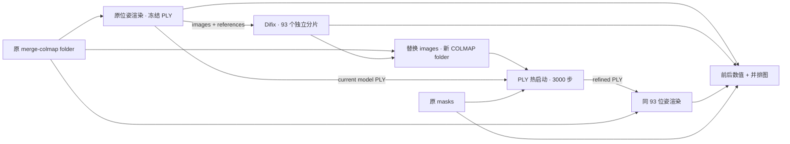

# Steven 自精炼闭环（2026-10-14）

工作流：`ca5d26f1-b30a-4c03-9511-31e4cb151d99`。新增 6 节点 / 15 连线；原 12 节点 / 18 连线的持久化字段逐项相等。8828 未重启，未操作旧僵尸分片。

## 侦察与复用

- FastGS 独立仓实际路径：`/cloud/cloud-ssd1/FastGS-Pano`。
- catalog 有 `fastgs-pano-render-metrics@0.1.0`，调用 `render.py`；输出 `render-dir`，不能直接满足 `arrayed<image>[frame]`。新增 renderer 复用同一 `Scene`、`GaussianModel`、`gaussian_renderer.render_fastgs`，直接读取 COLMAP 原位姿。
- `fastgs-pano-export-static` 用于动态模型指定时刻冻结；本次已提供冻结 PLY，无需重烘焙。`fastgs-foreground-export` 是前景 Gaussian 过滤，不是逐相机图片输出。
- catalog 已有 `fastgs-pano-fix`、`difix-prompt-cache`、`fastgs-colmap-overlay`。前者采样新视角并生成 `sparse_fixed/images_fixed`，后者通常供 `data_sources=both` 使用，不能满足原 93 位姿逐元素扇出和全部替换 GT，因此不直接使用。
- `tryouts/Difix3D/src/pipeline_difix.py`、`scripts/run_difix_img2img.py` 已存在。还有独立 `/cloud/cloud-ssd1/Diffusion/Difix3D` checkout。
- 本地 `tryouts/Difix3D/weights/nvidia/difix_ref` 完整：UNet 3,463,726,504 B；VAE 338,717,612 B；文本编码器 1,361,596,304 B，含 tokenizer、scheduler、定制 Python 模型代码。另有 `/cloud/cloud-ssd1/models/difix_ref`。未找到无参考 `nvidia/difix` 权重；本轮明确使用 **difix_ref + 同 stem 原始去畸变参考图**，不冒充无参考版。
- 环境：HoloLab `fastgs` → `/cloud/cloud-ssd1/conda/envs/fastgs`；torch 2.8.0+cu128、diffusers 0.25.1、transformers 4.38.0、peft 0.9.0、accelerate 0.34.2。已完成 CPU 离线完整加载；GPU 推理由真实 HoloLab 分片执行。
- FastGS 实际 CUDA 扩展名为 `diff_gaussian_rasterization_fastgs`，非标准 `diff_gaussian_rasterization`。
- 开始前 4090 空闲，无计算进程。GPU pack 声明 `exclusive: true`，启动时检查 GPU 计算 PID；Difix `parallelism=1`。

## 数据与模型

当前模型：`output/hololab/deliveries/steven-person-4d-reference-20261014/person_frozen_reference.ply`，t*=0，175,412 Gaussians，SHA256 `aaefe6af34ad7ac2d9558e9ba1153936a97674b69d01b12b094e9e207f6960fe`。

相机源：原 merge job `6cfc3767-e5a5-486c-a830-02f1bc75c93f/folder/sparse/0`，93 个位姿，按原 image stem 排序；不使用拟合环绕轨迹，不插值，不改变相机外参或内参。黑底，原始 1301×1301 尺寸输出。

Difix 使用 float16、seed=42、prompt=`remove degradation`、timestep=199、1 step、guidance=0。明确缩放至 648×648（max_side=650，8 对齐），推理后恢复 1301×1301；这是分辨率取舍，不能宣称恢复了原生 1301 像素细节。

新监督文件夹复制原 `sparse/` 的字节，逐 stem 校验完整性、重复、尺寸，再用全部修复图替换 `images/`；原图不混入训练监督，原图只用作 Difix 参考及独立数值对照。mask 复用原 `person-gray-mask` 输出并按 stem 对齐。组装方式采用 merge-colmap 的新文件夹思路，严格匹配，不使用数字后缀猜测。

原训练 pack 未提供初始模型端口；train.py 的 checkpoint 保存被注释。新增续训 pack 加载输入 PLY 的位置、SH、缩放、旋转、不透明度，构造初始化 checkpoint 再调用现有 `train.training`；**模型参数热启动，Adam 状态重置**。静态训练 3000 iterations（沿用 FastGS 最后一次只评估/保存、不做 optimizer step 的语义）、resolution=2、原 masked RGB loss，不增密、不重置 opacity；每 500 步保存 PLY。不是恢复动态网络及历史优化器，也不是从 SfM 点云重训。

## 节点及接线

| Pack | 输入 | 输出 | arrayable / 参数 |
|---|---|---|---|
| fastgs-camera-array | colmap-folder；可选 ply-3dgs | images/references: arrayed image[frame]；model: ply-3dgs；audit: text dir | false；ply_path 为未接 ply 时的显式当前模型路径 |
| difix-image | image file；reference image file | image file | **true**；画布开启扇出、parallelism=1、batch_size=1；max_side=650、seed=42 |
| replace-colmap-images | colmap-folder；arrayed image[frame] | colmap-folder | false；严格完整替换 |
| fastgs-refine-ply | colmap-folder；ply-3dgs；mask-dir | fastgs-model；ply-3dgs | false；iterations=3000 |
| fastgs-camera-array（after 实例） | 原 colmap-folder；续训 ply | 同上 | false；连接 ply 输入优先 |
| refinement-compare | before/after/fixed/references: arrayed image[frame]；mask-dir | text report dir（JSON + PNG） | false |

图像数组声明与 frame-extraction 一致：`tags: [image], arrayed: true, storage: dir, dim_labels: [frame]`。Difix 每次调用声明 file image → file image，平台聚合为同一 frame 轴的数组。

原流程节点和边保留；此图仅展示追加部分。一次闭环展开为 DAG，没有非法反馈边；下一轮可把新 PLY 接到新 renderer 的 ply 输入。

## 验证与证据

GT 组装专项测试：4 passed（替换内容且原输入不变、相机字节不变、缺帧拒绝、重复 stem 拒绝、尺寸变化拒绝）。所有 pack 已通过在线 catalog 加载；仅通过 pack_dirs 热刷新增加 Difix pack 来源，没有重启服务。

完整图前后快照、job 明细、各阶段输出和最终对照见 `output/hololab/deliveries/steven-self-refinement-20261014/`。完整闭环已完成；质量结论见下。

指标以 RGB [0,1] 计算，PSNR 为逐视角 dB 的算术均值。前景 PSNR 使用原 mask；清晰度另报告 mask 腐蚀 7×7 后的 Laplacian 方差，避免部分边界影响；mask 膨胀 11×11 外的 RGB 均值用于黑底残留亮度诊断（不是 alpha 或几何真值）。Laplacian 上升也可能来自噪声，必须结合并排图。全部是训练视角诊断，非 held-out 泛化评估。

## 一轮实测结果：链路通过，质量未通过

所有阶段在 HoloLab 运行成功，Difix 为 93/93 独立成功分片。各修复 PNG 的 SHA256 均不同于对应渲染及原始参考图，详见 `image-lineage.json`；完整分片 job ID、时长、显存记录见 `difix-shards.json`。

| 阶段 | Job ID | 状态 | Job 墙钟秒（started → updated，含平台收尾） |
|---|---|---|---:|
| refine-render-before | `7dd35ba9-5bcb-4e9d-a2ca-4590908bf81e` | done | 93.96 |
| refine-difix | `fddd3aa3-52f2-40d3-a989-8db57f1241aa` | done | 883.55 |
| refine-data | `05448762-01c9-4c23-a395-9a95efb53338` | done | 0.02 |
| refine-train | `391822cb-aa35-4b8e-8e73-d4b589101e79` | done | 20.56 |
| refine-render-after | `ebfe8a11-7263-4ed9-8f1d-906f420b244f` | done | 97.15 |
| refine-compare | `f76ded4e-720f-4795-8f59-2181c4047e3b` | done | 0.02 |

Snapshot：`8db73969-d01a-4dec-9654-6b508e55ab67`（通过 Continue 增加新节点执行，不重跑旧节点）。渲染前后相机 R/T、image stem、尺寸完全一致；原 sparse 的全部 9 文件 SHA256 完全一致。

训练脚本计时 21.832 秒，3000 iterations，Gaussian 数 175,412 → 175,412，无增密；最终参数全为有限值，PLY 哈希已改变。峰值 torch 分配显存：初始渲染 0.957 GiB，Difix 单图全批最大 4.824 GiB，训练 0.605 GiB；这不是 nvidia-smi 的整进程保留显存。

| 93 视角算术均值 | 闭环前 | Difix 目标 | 续训后 |
|---|---:|---:|---:|
| 前景 PSNR / dB | 23.11565604 | 21.20371645 | 21.14500702 |
| 全图 PSNR / dB | 9.84430651 | 10.15099836 | 9.89790336 |
| 前景内部 Laplacian 方差 | 0.00016680 | 0.00014535 | 0.00012940 |
| mask 外 RGB 均值 | 0.01223017 | 0.02993922 | 0.01721852 |

前景 PSNR 平均 **下降 1.971 dB**，仅 **4/93** 视角上升。最差为 frame_000000：−7.457 dB；最佳 frame_000076：+0.456 dB。前景内部清晰度代理下降 22.4%；黑底 mask 外残留亮度上升 40.8%。全图 PSNR 的 +0.054 dB 很小，且受原观测灰底 / 渲染黑底差异影响，不能据此认定改善。

已亲自打开 `frame_000000/000023/000046/000069/000092.png` 全部 5 组四列对照（原观测 / 冻结版渲染 / Difix 目标 / 续训渲染）。侧面手臂和部分手指的拖影有所减轻，但 Difix 改变了肤色/亮度、细节偏软并带入灰背景；续训没有消除全部轮廓飞散，正面参考视角退化明显。**不能把该结果交付为更好的当前模型。** 原冻结 PLY 未覆盖，新模型仅作为本轮实验产物保存。

## 交付与遗留

- 完整已接线图：在线 workflow；离线 `workflow-after.json`，另附带并发保护时间戳的 `workflow-save-payload.json`。
- 新模型：`output/hololab/deliveries/steven-self-refinement-20261014/person_refined.ply`，SHA256 `c0ea5dd046cbadffbfc79c196d85de365249c79a1fea7df224dd32aefc4b979c`。保留原冻结版作为基线，不自动替换。
- 对照：同目录 `comparison/summary.json`、`per_view.json` 与 5 张并排 PNG。原始全部 before/fixed/after 图片仍在各 HoloLab job 输出。
- 审计：`preservation.json`、`camera-comparison.json`、`sparse-preservation.json`、`image-lineage.json`、`difix-weights.json`、`training.json`、`jobs.json`、`job-details.json`、`difix-shards.json`。
- 功能闭环已完成，无缺依赖导致的阻塞；**质量提升仍未实现**。本轮使用参考版且降采样推理，不代表无参考 Difix 或原生分辨率修复的效果。
- 原 mask 只用于 masked RGB loss，未新增 alpha/silhouette loss；这可能限制了 mask 外飞散点的修正。颜色保真约束、mask 感知修复、提高修复分辨率，以及续训学习率/轮廓监督需要另做受控实验，本轮没有验证这些改进。
- 当前入口是静态 PLY 参数热启动；不恢复动态网络和旧 Adam 状态。后续多轮可用产出的 PLY 作为新 renderer 的输入，保持 DAG 展开。
- 后端/前端无改动，原 pack 无改动，只有新 pack、专项测试及此报告；没有重启 8828，没有清理僵尸任务。

独立仓提交：FastGS-Pano `7e40893`（仅新增 renderer / PLY 续训 pack）；Difix3D `9f120f3`（仅新增 per-image pack）。HoloLab 的本次提交只包含两项通用 pack、GT 组装测试和本报告；其余 WIP 保留，根仓 submodule 指针未提交，未 push。最终三仓完整提交号另存交付目录 `commits.json`。
